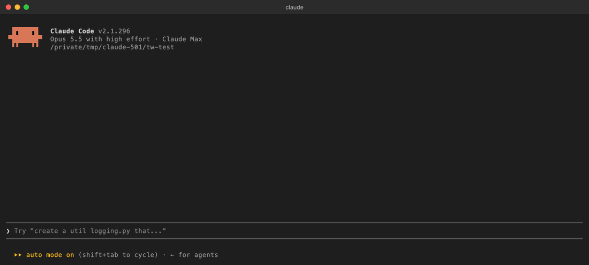

<div align="center">

# ◆ tripwire

**A Claude Code mod that holds a destructive command and shows you what it would destroy — before it runs.**

[](https://code.claude.com/docs/en/plugins/mods/overview)
[](#compatibility)
[](LICENSE)



</div>

One bad `rm -rf`, one force push to the wrong branch, one `git reset --hard` — and hours of
work are gone. Claude Code's permission prompt tells you *what* command is about to run.
Tripwire tells you **what it would take with it**, then waits for your answer.

```text
╭──────────────────────────────────────────────────────────╮
│ ◆ tripwire · Recursive delete                            │
│ rm -rf build                                             │
│ 17 paths · 56K would be deleted                          │
│   build                                                  │
│   build/index.html                                       │
│   build/chunks                                           │
│   build/chunks/list.js.map                               │
│   …                                                      │
│ Answer in Claude's dialog · Cancel is the default        │
╰──────────────────────────────────────────────────────────╯
tripwire · 17 paths · 56K would be deleted
rm -rf build
  1: Cancel   2: Proceed
```

## Install

Inside Claude Code:

```text
/plugin marketplace add flaviorg/tripwire
/plugin install tripwire@tripwire
```

Then start a new session, or run `/reload-plugins`. Tripwire is also listed in my
[claude-mods](https://github.com/flaviorg/claude-mods) marketplace with my other mods.

## What it holds

| | Command | What the pane shows |
|---|---|---|
| ● | `rm -r` / `rm -rf` / `rm` with a glob | How many paths and how much disk space, with the first 30 paths |
| ● | `git push --force`, `-f`, `--force-with-lease` | The remote commits that would be overwritten |
| ● | `git reset --hard` | The changed files that would be discarded |
| ● | `git checkout -- .`, `git restore .` | The changed files that would be discarded |
| ○ | `git clean -f` | What `git clean -n` would remove |
| ○ | `git branch -D` | The unmerged commits on that branch |
| ● | `DROP TABLE` / `DROP DATABASE` / `TRUNCATE` | The statement |
| ○ | `chmod -R 777` | The path |

● high severity · ○ medium. Commands are checked segment by segment, so
`cd app && sudo rm -rf build` is caught and measured inside `app/`.

## How it decides

1. A `tool.call` hook sees every Bash command before it runs. Safe commands pass straight
   through — no delay, no prompt.
2. A hit runs at most two **read-only** commands (`find`, `du`, `git log`, `git status`,
   `git clean -n`) with a 2-second timeout each to measure the damage.
3. The pane opens with the blast list, and Claude's question dialog asks
   **Cancel / Proceed**. Cancel is first and is the default.
4. **Proceed** lets the command continue to Claude Code's normal permission check.
   Anything else — Cancel, a typed answer, a dismissed dialog, a headless `claude -p` run —
   denies it, and Claude reads why.
5. If tripwire itself fails before deciding, the command is denied. It fails closed.

Tripwire is a safety net, not a permission system: keep your normal permissions on.

## Commands

| Command | What it does |
|---|---|
| `/tripwire` | Lists the rules and every command held in this session, with your decision |

## Options

Set them with `/plugin configure tripwire@tripwire`:

| Option | Values | Default | What it does |
|---|---|---|---|
| `mode` | `ask`, `deny`, `off` | `ask` | `deny` refuses hits without asking; `off` disables the guard |
| `extraPatterns` | comma-separated regexes | *(empty)* | Extra commands to hold, e.g. `terraform destroy,kubectl delete` |
| `allowPaths` | comma-separated folder names | *(empty)* | Folders `rm -rf` may delete without a hold, e.g. `dist,build,.cache` |

## Privacy

Tripwire reads no files of yours and makes no network requests. On a hit it runs read-only
`find`, `du` and `git` commands in your working directory. You can confirm this before
installing:

```bash
claude plugin validate ./tripwire
```

The `calls:` line lists every mods API call it makes.

## Compatibility

Tested with Claude Code **2.1.296** in the terminal and the Desktop app's Code tab. Mods need
Claude Code 2.1.287 or later. In `claude -p` runs nobody can answer the dialog, so a hit is
denied.

## Development

```bash
claude plugin validate --strict .   # manifest, hooks and calls
claude plugin test .                 # 26 tests, no session or sign-in needed
claude --plugin-dir .                # try it in a session; edits hot-reload
```

Design notes live in [`docs/superpowers/plans`](docs/superpowers/plans). Inspired by
Anthropic's `blast-radius` sample mod; written from scratch against the public mods API.

## License

[MIT](LICENSE) © flaviorg
